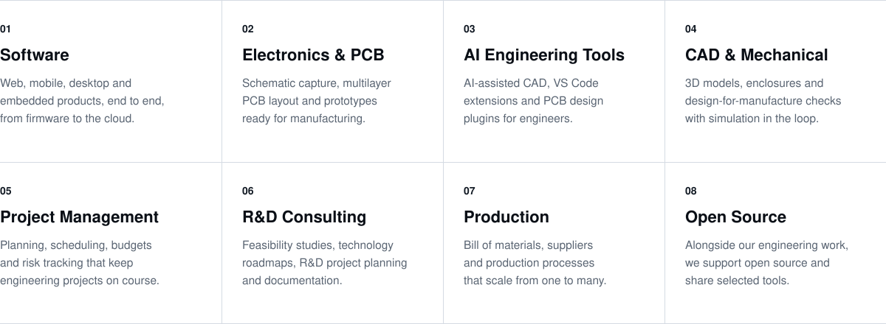
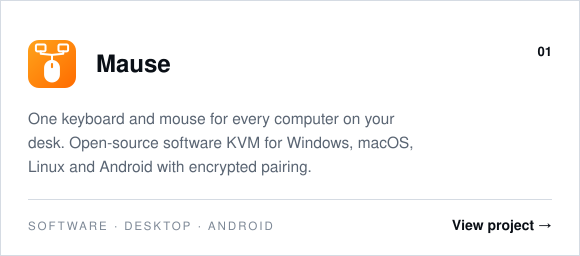
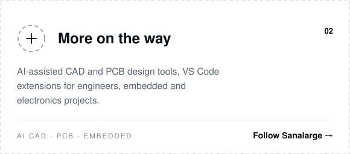

  

  We design software, circuits and the AI tools engineers use to build them, 
  manage projects and R&amp;D from plan to production, and support open source along the way.

 

  

 

## What we do

<picture>
  <source media="(prefers-color-scheme: dark)" srcset="assets/sag-services-dark.svg">
  
</picture>

## How we work

<picture>
  <source media="(prefers-color-scheme: dark)" srcset="assets/sag-flow-dark.svg">
  
</picture>

## Projects

Our work spans software, electronics, CAD and AI engineering tools. New projects are added here as they are released.

  <a href="https://github.com/Sanalarge/mause"><picture>
    <source media="(prefers-color-scheme: dark)" srcset="assets/sag-project-mause-dark.svg">
    
  </picture></a>
  <a href="https://github.com/Sanalarge"><picture>
    <source media="(prefers-color-scheme: dark)" srcset="assets/sag-project-next-dark.svg">
    
  </picture></a>

<b>Türkçe</b>

 

**Sanalarge**; yazılım, elektronik ve yapay zekâ destekli mühendislik üzerine çalışan bir mühendislik stüdyosudur. Mühendislik çalışmalarımızın yanında açık kaynak dünyasına da destek veriyoruz.

- **Yazılım:** Web, mobil, masaüstü ve gömülü sistemler; donanım yazılımından buluta uçtan uca ürünler.
- **Elektronik ve PCB:** Şema tasarımı, çok katmanlı PCB çizimi ve üretime hazır prototipler.
- **Yapay zekâ ile mühendislik:** Yapay zekâ destekli CAD tasarımı, VS Code eklentileri ve PCB tasarım eklentileri.
- **CAD ve mekanik:** 3B modelleme, kutu tasarımı, üretilebilirlik kontrolleri ve simülasyon.
- **Proje yönetimi:** Planlama, zaman çizelgesi, bütçe ve risk takibiyle mühendislik projelerini hedefinde tutma.
- **Ar-Ge danışmanlığı:** Fizibilite çalışmaları, teknoloji yol haritaları, Ar-Ge proje planlama ve dokümantasyon.
- **Üretim:** Malzeme listesi, tedarik ve ölçeklenebilir üretim süreçleri.
- **Açık kaynak:** Mühendislik işlerimizin yanında açık kaynağı destekliyor, seçili araçlarımızı toplulukla paylaşıyoruz.

**Projeler:** Toplulukla paylaştığımız ilk proje [Mause](https://github.com/Sanalarge/mause). Yapay zekâ destekli CAD ve PCB araçları, VS Code eklentileri, gömülü sistem ve elektronik projelerimiz yayımlandıkça bu sayfaya eklenecek.

 

  
  

